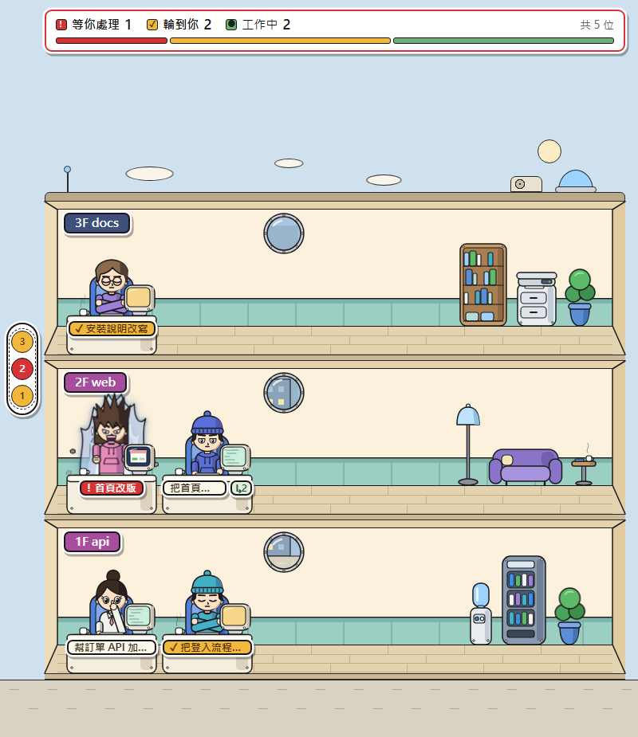
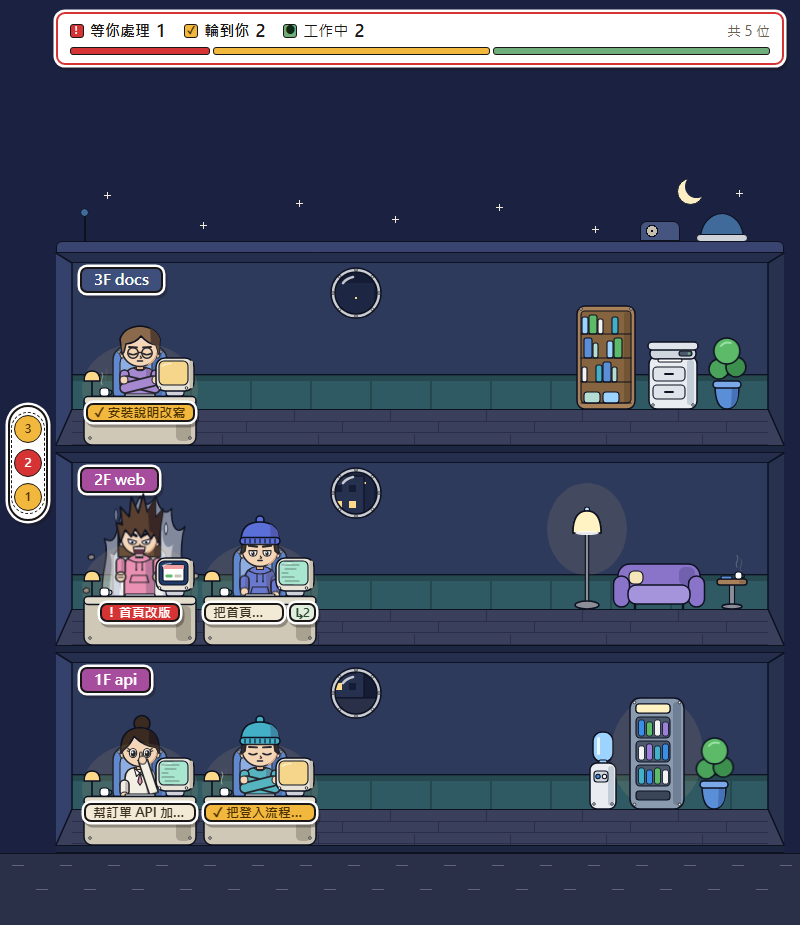

# Claude 辦公室

> 在本機網頁上，把你的 Claude Code session 畫成一棟剖面大樓：一個工作資料夾（cwd）一層樓，一個 session 一位員工。

同時開好幾個 session 時，你不用逐一切過去看，就知道哪個還在跑、哪個在等你處理、哪個已經做完輪到你。



*白天（`?time=day`）：三個專案三層樓，有人工作中、等你處理、輪到你，2F 名牌以「↳」開頭的兩位是工作中的助理；滑鼠停在右邊那位助理身上，打開它的資訊卡。*



*夜晚（`?time=night`），同一個畫面，打開的是 2F 等你處理那個人的資訊卡。*

## 快速開始

完成這四步後，你的 Claude Code session 會以員工的樣子出現在 http://127.0.0.1:47823 。

**需求**：Node.js 18 以上（以 Node 22 開發）。Windows 另需 Git for Windows，因為 Claude Code 經由 Git Bash 執行 hook。

先取得原始碼：

```bash
git clone https://github.com/DavidQiu23/claude-office.git
cd claude-office
```

1. 安裝相依套件：

   ```bash
   npm install
   ```

2. 建置後端與前端，輸出到 `dist/`：

   ```bash
   npm run build
   ```

3. 把 hooks 寫進 `~/.claude/settings.json`：

   ```bash
   npm run install-hooks
   ```

4. 啟動伺服器：

   ```bash
   npm start
   ```

啟動成功時會顯示 `Claude Office 已啟動：http://127.0.0.1:47823`。用瀏覽器打開這個網址。已經開著的 session 要等下一個事件（例如你送出下一個 prompt）才會出現。

## 一鍵啟動（Windows）

裝好之後，不用再下指令：雙擊資料夾裡的 `office.bat`，伺服器沒開就先開，再用預設瀏覽器打開大樓。想放桌面的話，對它按右鍵建立捷徑，不要複製檔案本身。

- 伺服器跑在縮到工作列的「Claude Office」視窗，關掉視窗就停止。已經開著時再雙擊一次，只會打開頁面。
- 伺服器啟動後才收得到事件，所以已經開著的 session 一樣要等下一個事件才會出現。

## 安裝與移除 hooks

```bash
npm run install-hooks
```

- 你要**先 build 再安裝**：hook 指向 `dist/hook/send.js`。
- 安裝會寫入 `~/.claude/settings.json`，共 13 個事件：SessionStart、UserPromptSubmit、PreToolUse、PostToolUse、PostToolUseFailure、PermissionRequest、Notification、Elicitation、ElicitationResult、Stop、StopFailure、SubagentStop、SessionEnd。成功時顯示 `已安裝 hooks：<路徑>`。
- hook 記的是這個資料夾的絕對路徑：**搬移資料夾後要再執行一次**。重複執行不會重複新增。
- 第一次修改前會備份成 `settings.json.claude-office.bak`，之後不再覆蓋，永遠是最初的原始檔。
- 送事件最多等 300 毫秒，伺服器沒開時靜默結束，不影響 Claude Code。

移除時只拿掉帶 `--tag=claude-office` 的項目，你的其他 hook 保留：

```bash
npm run uninstall-hooks
```

## 設定

設定檔只有 `port` 一個選項，預設 `47823`。資料夾與檔案預設不存在，要自己建立：

```json
{"port": 50000}
```

- macOS / Linux：`~/.claude-office/config.json`
- Windows：`%USERPROFILE%\.claude-office\config.json`

伺服器、hook 與 `simulate` 都讀這個檔。檔案不存在、無法解析或 port 不是 1–65535 的整數時，用預設值。改完要**重新啟動伺服器**，hook 不必重裝。伺服器只監聽 127.0.0.1，只有本機看得到。

## 示範（simulate）

手邊沒有 session 時，你可以送模擬事件看看效果。先在另一個終端機啟動伺服器：

```bash
npm start
```

跑一輪（約 28 秒，最多 3 層、5 位員工和 2 位助理；終端機會印出目前在演哪個情境：三種狀態、狀態切換、助理、加蓋與拆樓、退場中又回來、交班、全部下班）：

```bash
npm run simulate
```

或一直重複：

```bash
npm run simulate -- --loop
```

中途按 Ctrl+C 會停在當下畫面，模擬員工留在大樓裡，直到你按「請他下班」或重啟伺服器（狀態只存在記憶體）。模擬不會寫入 `~/.claude` 或 `~/.claude-office`，只在系統暫存資料夾寫假的 transcript，結束時刪除。

## 白天與夜晚

- 本機時間 6:00（含）到 18:00（不含）是白天，其餘是夜晚；頁面開著時會自動切換。
- 網址加 `?time=day` 或 `?time=night` 可以固定。系統的深色模式不影響。
- 夜晚的房間蓋一層深藍色。有人的桌子桌燈和螢幕亮著（輪到你的螢幕發琥珀光，空桌不亮），窗外夜空、立燈和販賣機也亮著；名牌、招牌、狀態列、電梯面板和資訊卡和白天一樣清楚。

## 三種狀態

每個狀態只有一個動作。名牌和電梯燈的紅、琥珀兩色日夜相同；工作中的綠色只出現在狀態列和資訊卡，名牌是米白色。

| 狀態 | 動作 | 名牌 | 觸發事件 |
| --- | --- | --- | --- |
| 工作中 | 坐著飛快打字，手後面拖著兩層半透明殘影；螢幕上的程式碼在捲動 | 米白色 | UserPromptSubmit、PreToolUse（AskUserQuestion 除外）、PostToolUse、PostToolUseFailure、ElicitationResult |
| 等你處理 | 站起來爆氣：握拳大喊、頭髮豎起、全身發抖，背後冒半透明白色的火焰氣場（白天外圍多一圈藍色光暈，夜晚周圍映出紅光），桌子兩側有小石子往上飄；螢幕顯示權限對話框 | 紅色，以「!」開頭 | PermissionRequest、PreToolUse 的 AskUserQuestion、Elicitation、權限或輸入類的 Notification |
| 輪到你 | 坐著抱胸、閉眼冥想；螢幕變琥珀色，桌上的馬克杯冒煙 | 琥珀色，以「✓」開頭 | Stop、StopFailure；剛出現、還沒有其他事件的新 session |

- **登場**：新的 session 一出現，人就在座位上瞬移登場：先閃兩下光痕，人從一條線變寬出現。打開頁面時已在的人直接坐好。
- **下班**：站起來雙指點額，再閃爍、壓成一條光痕消失。CLI 的 session 發生在 SessionEnd、你按「請他下班」，或 12 小時沒有任何事件時；Claude Desktop 的 session 見下一條。
- **Claude Desktop 的 session**：在 Desktop 裡封存或刪除 session（最多晚 1 分鐘）、或你按「請他下班」時才下班，閒置多久都不會離開。rewind 或 Desktop 暫停閒置 session 只會讓員工變成「輪到你」，長相、座位、標題和 prompt 都不變。名牌標題用 Desktop 顯示的標題。在 Desktop session 裡用指令開的 `claude` 算另一位員工，規則和 CLI 相同。
- **接續的 session**：Claude Code 把對話接到新的 session（新的 session_id）時，仍是同一位員工，長相和座位都不變，不會多出一個人。

## 助理（subagent）

- 工作中的助理坐在主人那層的空桌打字（沒有空桌就加一張），名牌是「↳ 類型 · 描述」，沒有類型時只有描述，兩個都沒有時是「↳ 助理」。
- 一開始工作就瞬移登場，完成就退場；主人下班時一起退場。用 SendMessage 叫回已停下的助理時，它會再登場一次，描述換成這次叫回的摘要。
- 滑鼠移到助理身上，看描述、目前動作、類型、主人的標題和開始時間。目前動作隨助理用的工具更新，第一個工具之前不顯示。主人的資訊卡也列出他的助理，包含剛完成的，但不列目前動作。
- 助理要權限時，主人也算等你處理，但資訊卡和狀態列下方寫的是主人自己的動作（例如「派出助理」），不是助理要批准什麼。
- 不影響電梯面板的燈色，也不算進狀態列與分頁標題的人數。主人被請下班後又回來時，助理不會跟著回來。

## 畫面上的其他東西

- **樓層**：一個工作資料夾（cwd）一層，先到的在 1F，新的蓋在最上面；同名資料夾的招牌顯示路徑最後兩層，滑鼠停在招牌上看完整路徑。整層沒人才拆掉，上面的樓層往下補。人走了（包括助理做完）桌子留著，整層拆掉才收。各層同寬；一層桌子放不下時整棟樓變寬，整頁可以左右捲。打開頁面時停在 1F。
- **沒人上班**：畫面是一層空大廳，中間的紙條寫「目前沒有人上班」。
- **名牌**：顯示 session 的標題（Claude Code 自動取的 ai-title）；還沒有標題時用第一個 prompt。標題在第一輪回應結束後才讀得到，所以新 session 的名牌會從 prompt 換成標題。
- **環境**：盆栽會輕輕晃、咖啡會冒煙，都比等你處理的人安靜。系統開了「減少動態」時，所有動畫和瞬移都停住，姿勢、表情和名牌顏色照樣顯示。
- **電梯面板**：固定在左側，一層一顆鈕，滑鼠停在鈕上看樓層名稱。紅燈加「!」＝有人等你處理，琥珀燈加「✓」＝有人輪到你。虛線框圈出目前畫面上看得到的樓層。點了捲到那層。
- **狀態列**：黏在頂端，列出三種狀態的人數；有人等你時外框變紅，下方列出等最久的人（最多 3 位，放不下的併成「+N」），寫明樓層、標題和要批准什麼，點一下捲到那個人。
- **連線中斷**：連不上伺服器時，狀態列外框變墨色虛線，下方寫「連線中斷，畫面停在 HH:mm」取代紅條，所有人停住，分頁標題加「(斷線)」。畫面上的狀態是斷線當下的樣子。重新連上會自動恢復。
- **分頁標題**：例如 `(!1 ✓2) Claude 辦公室`，分頁在背景也看得到。
- **資訊卡**：滑鼠移到人身上，或用 Tab 選到人，顯示標題、狀態標籤、資料夾、目前動作、最近與第一個 prompt（相同時只顯示一個；助理完成這類系統通知不算）、助理清單與到班時間。捲動頁面時資訊卡會收起來，按 Esc 也會。
- **鍵盤**：Tab 依序走紅條、電梯按鈕和每個人；選到人時按 Enter 或空白鍵進到資訊卡的「請他下班」，再按 Tab 或 Esc 回到那個人。
- **請他下班**：資訊卡上的按鈕，按下立即讓員工離開，沒有確認步驟。只從畫面移走；那個 session 還在用的話，下一個事件會讓他重新登場。失敗時卡片底部顯示「操作失敗，請稍後再試」。

## 疑難排解

- **畫面一直是空的**：看到「目前沒有人上班」的紙條，代表頁面正常，只是還沒收到任何 session 的事件：已開著的 session 要等下一個事件；新 session 也不出現的話，看下面「裝了 hook 卻沒反應」。連紙條都沒有的話，確認 `npm start` 還在跑，網址的 port 與設定一致。
- **`port 47823 已被占用，請在 … 修改 port`**：伺服器會結束。訊息裡會寫出這台機器上設定檔的完整路徑，在那裡換一個 port。
- **`office.bat` 顯示「伺服器沒有啟動」**：打開工作列上的 Claude Office 視窗看原因，通常是 port 被占用。看完關掉那個視窗。
- **改了 port 沒反應**：重新啟動伺服器。
- **重啟伺服器後畫面清空**：狀態只存在記憶體，各 session 要等下一個事件才會回來。
- **`Cannot find module`，指向 `dist/...`**（`npm start`、`install-hooks`、`uninstall-hooks` 都可能出現）：還沒 build，先執行 `npm run build`。
- **`settings.json 不是合法的 JSON，已中止，未做任何修改`**：先修好 `~/.claude/settings.json` 的格式，再執行一次 `install-hooks`。
- **`settings.json 的 hooks 欄位不是物件，已中止，未做任何修改`**：`hooks` 要是物件（`{}`），修好後再執行一次。
- **裝了 hook 卻沒反應**：確認 `~/.claude/settings.json` 裡有帶 `--tag=claude-office` 的指令，且 Claude Code 的環境找得到 `node`。
- **`送不出事件。伺服器沒開？請先 npm start`**：`simulate` 找不到伺服器，先啟動 `npm start`。
- **Windows 上所有 hook 一起逾時**：用 PowerShell 跑 `& "C:\Program Files\Git\bin\bash.exe" -c "echo ok"`，正常約 0.2 秒。
  若約 15 秒後崩潰（`add_item ... failed, errno 1`），是 Git for Windows 的 MSYS 共用記憶體鎖卡住，不是本專案 hook 的問題（見 git-for-windows/git#6368）。
  要把 `C:\Program Files\Git` 底下的 MSYS 行程全部結束才會恢復。其他開著的 Claude Code session 會馬上再開新的 bash，所以只結束一次通常沒用，要連續清到一個都不剩。在 PowerShell 執行下面這段，清完再量一次 `echo ok`：

  ```powershell
  function Get-Msys { Get-Process | Where-Object { $_.Path -like 'C:\Program Files\Git\usr\bin\*' -or (($_.Name -in 'bash','sh') -and $_.Path -like 'C:\Program Files\Git\*') } }
  $z=0; for ($i=0; $i -lt 60 -and $z -lt 3; $i++) { $p=Get-Msys; if ($p) { $p | Stop-Process -Force -ErrorAction SilentlyContinue; $z=0 } else { $z++ }; Start-Sleep -Milliseconds 100 }
  ```

  其他 session 正在跑的 Bash 指令和開著的 Git Bash 視窗會被中斷。

## 更新

```bash
git pull
npm install
npm run build
```

然後重新啟動伺服器（用 `office.bat` 的話，關掉 Claude Office 視窗再雙擊一次）。新版若多了 hook 事件，再跑一次 `install-hooks`（不會重複新增）。

## 完全移除

1. 先執行 `npm run uninstall-hooks`（`dist/` 不在時先 `npm run build`）。直接刪資料夾的話，`settings.json` 裡的 hook 會指向不存在的檔案。
2. 刪掉這個資料夾。
3. 視需要刪掉 `~/.claude-office/` 與 `~/.claude/settings.json.claude-office.bak`（最初的原始檔）。

## 已知限制

- 強制結束 Claude Code 時收不到 Stop／SessionEnd，員工會停在原狀態，直到下一個事件、你按「請他下班」或 12 小時後離開。按 Esc 中斷或直接關終端機是否一樣，還沒確認。
- Claude Desktop 的 session 是否結束，是讀 Desktop 自己的 session 紀錄判斷的，這不是公開格式，目前只在 Windows 商店版驗證過。讀不到時退回 12 小時沒有事件就下班。
- 背景執行（`run_in_background`）的助理要等 SubagentStop 才算完成。
- Notification 權限提示、AskUserQuestion、MCP Elicitation 依官方 hooks 文件實作，還沒在互動式 session 實測。

## 開發

```bash
npm test
```

```bash
npm run build
```

`npm test` 會先用 `tsc` 重新編譯後端到 `dist/`，但不建置前端。

`build` 依序執行 `tsc`（`src/` 編譯到 `dist/`）、`tsc -p web`（前端型別檢查）與 `vite build`（前端輸出到 `dist/web`）。

| 位置 | 內容 |
| --- | --- |
| `office.bat` | Windows 一鍵啟動：伺服器沒開就開，再打開瀏覽器 |
| `src/hook/send.ts` | hook 腳本，把事件 POST 給伺服器 |
| `src/server/main.ts`、`app.ts` | 啟動入口；本機伺服器（收事件、狀態只存在記憶體、以 SSE 推給頁面） |
| `src/server/title.ts` | 從 transcript 讀 ai-title 當名牌標題，讀 `continued-in` 把接續的 session 認成同一位員工 |
| `src/server/desktop.ts` | 讀 Claude Desktop 的 session 紀錄：是否已封存或刪除、標題、用過的 session_id |
| `src/state` | 由事件整理出員工與助理狀態 |
| `src/installer` | 安裝／移除 hooks |
| `src/config.ts` | 讀設定檔 |
| `scripts/simulate.ts` | 模擬事件 |
| `web/src/floors.ts` | 樓層、座位、電梯燈、各層共用寬度等純計算，尺寸常數 `GEO` |
| `web/src/building.ts`、`floor.ts`、`person.ts` | 大樓、單層樓、單一人物 |
| `web/src/figure.ts`、`objects.ts` | 人物的 SVG；桌子、圓窗與窗景、家具、樓層兩側斜牆和地板板縫的 SVG |
| `web/src/furniture.ts` | 每層樓的家具組合，窗和招牌的位置 |
| `web/src/elevator.ts`、`card.ts`、`main.ts` | 電梯面板、資訊卡、狀態列與分頁標題 |
| `web/index.html` | 頁面入口 |
| `web/src/theme.ts`、`web/src/styles/theme.css` | 日夜判斷（6:00–18:00 白天）、配色與夜晚遮罩的顏色 |
| `web/src/view.ts` | 名牌文字、狀態摘要、人物外觀和動作錯開的延遲、專案色 |
| `web/src/sync.ts` | 連伺服器收事件、回報連線狀態、前端的員工狀態 |
| `web/src/svg.ts`、`dom.ts`、`motion.ts` | SVG 與 DOM 小工具、減少動態判斷 |
| `web/src/styles/*.css` | 大樓、人物、資訊卡與狀態列等樣式 |
| `test/` | vitest 測試 |

錄製真實事件：在 hook 指令後加 `--record=<資料夾>`，事件會存成 JSON 檔、不送伺服器：

```bash
node "<這個資料夾>/dist/hook/send.js" --tag=claude-office --record=<資料夾>
```

`--tag=claude-office` 要留著，`install-hooks`／`uninstall-hooks` 靠它認出自己的項目。`test/fixtures/` 是用暫存的 settings 檔搭配 `claude --settings <檔>` 錄的，不必改 `~/.claude/settings.json`；改了的話，再跑一次 `install-hooks` 會蓋回一般模式。

設計理由與規則見 [docs/design.md](docs/design.md)。
