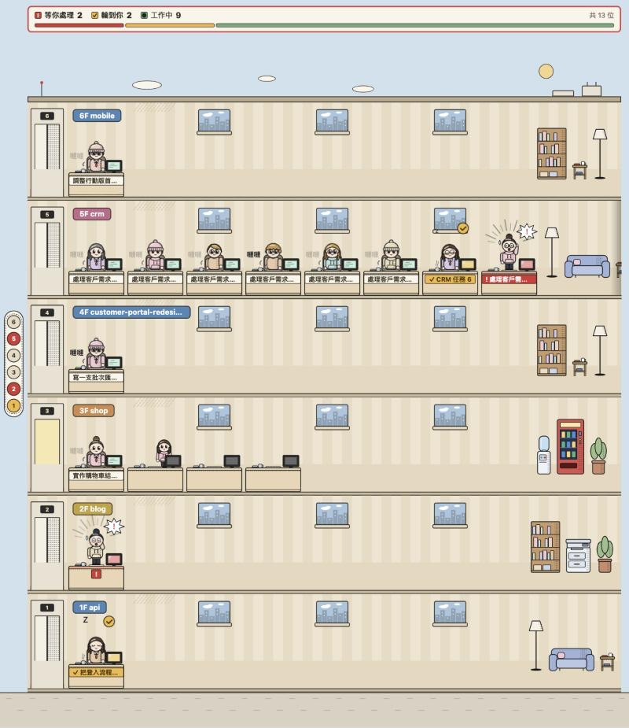
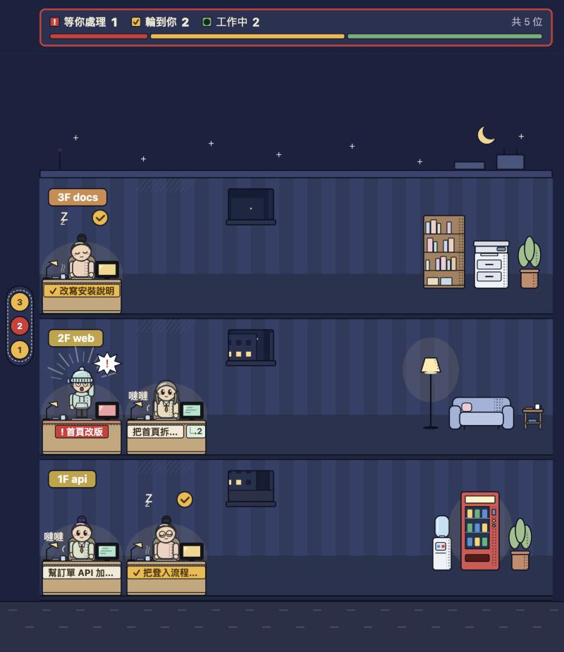

# Claude 辦公室

> 在本機網頁上，把你的 Claude Code session 畫成一棟剖面大樓：一個專案一層樓，一個 session 一位員工。

同時開好幾個 session 時，你不用逐一切過去看，就知道哪個還在跑、哪個在等你批准、哪個已經做完輪到你。



*白天（`?time=day`），`npm run simulate` 跑到一半的畫面。*



*夜晚（`?time=night`），同一份劇本。*

## 快速開始

完成這四步後，你的 Claude Code session 會以員工的樣子出現在 http://127.0.0.1:47823 。

**需求**：Node.js（以 Node 22 開發）。Windows 另需 Git for Windows，因為 Claude Code 經由 Git Bash 執行 hook。

```bash
npm install
```

```bash
npm run build
```

```bash
npm run install-hooks
```

```bash
npm start
```

啟動成功時會顯示 `Claude Office 已啟動：http://127.0.0.1:47823`。用瀏覽器打開這個網址。已經開著的 session 要等下一個事件（例如你送出下一個 prompt）才會出現。

## 安裝與移除 hooks

```bash
npm run install-hooks
```

- 你要**先 build 再安裝**：hook 指向 `dist/hook/send.js`。
- 安裝會寫入 `~/.claude/settings.json`，共 13 個事件：SessionStart、UserPromptSubmit、PreToolUse、PostToolUse、PostToolUseFailure、PermissionRequest、Notification、Elicitation、ElicitationResult、Stop、StopFailure、SubagentStop、SessionEnd。成功時顯示 `已安裝 hooks：<路徑>`。
- hook 記的是這個資料夾的絕對路徑：**搬移資料夾或更新版本後，重新 build 並再執行一次**。重複執行不會重複新增。
- 第一次修改前會備份成 `settings.json.claude-office.bak`，之後不再覆蓋，永遠是最初的原始檔。
- hook 最多等 300 毫秒，伺服器沒開時靜默結束，不影響 Claude Code。

移除時只拿掉帶 `--tag=claude-office` 的項目，你的其他 hook 保留：

```bash
npm run uninstall-hooks
```

## 設定

設定檔只有 `port` 一個選項，預設 `47823`：

```json
{"port": 50000}
```

- macOS / Linux：`~/.claude-office/config.json`
- Windows：`%USERPROFILE%\.claude-office\config.json`

伺服器、hook 與 `simulate` 都讀這個檔。檔案不存在、無法解析或 port 不是 1–65535 的整數時，用預設值。改完要**重新啟動伺服器**，hook 不必重裝。伺服器只監聽 127.0.0.1，只有本機看得到。

## 示範（simulate）

手邊沒有 session 時，你可以送模擬事件看看效果。先在另一個終端機啟動伺服器：

```bash
npm start
```

跑一輪（約 22 秒，涵蓋多樓層、擠滿的樓層、助理、三種狀態、拆樓與加蓋）：

```bash
npm run simulate
```

或一直重複：

```bash
npm run simulate -- --loop
```

中途按 Ctrl+C 會停在當下畫面，模擬員工留在大樓裡，直到你按「請他下班」或重啟伺服器（狀態只存在記憶體）。模擬不會寫入 `~/.claude` 或 `~/.claude-office`。

## 白天與夜晚

- 本機時間 6:00（含）到 18:00（不含）是白天，其餘是夜晚；頁面開著時會自動切換。
- 網址加 `?time=day` 或 `?time=night` 可以固定。系統的深色模式不影響。

## 三種狀態

每個狀態只有一個動作，白天夜晚顏色相同。

| 狀態 | 動作 | 名牌 | 觸發事件 |
| --- | --- | --- | --- |
| 工作中 | 坐著打字，旁邊有「噠噠」 | 米白色 | UserPromptSubmit、PreToolUse（AskUserQuestion 除外）、PostToolUse、PostToolUseFailure、ElicitationResult |
| 等你處理 | 站起來舉手，集中線、「！」尖角框、汗滴 | 紅色，以「!」開頭；電梯燈紅 | PermissionRequest、PreToolUse 的 AskUserQuestion、Elicitation、權限或輸入類的 Notification |
| 輪到你 | 坐著打瞌睡，飄著「zZ」，頭上琥珀色打勾泡泡 | 琥珀色，以「✓」開頭；電梯燈琥珀 | Stop、StopFailure；剛出現、還沒有其他事件的新 session |

員工在這些時候走回電梯下班：SessionEnd、你按「請他下班」，或 12 小時沒有任何事件。

## 助理（subagent）

- 坐在主人那層的桌子打字，名牌以「↳」開頭（有類型時是「↳ 類型 · 描述」）。
- 完成後名牌變「↳ ✓ 完成」，3 秒後直接走回電梯離開。
- 不算在電梯燈、邊緣提示、狀態列與分頁標題的數字裡。

## 畫面上的其他東西

- **樓層**：先到的專案在 1F，新專案蓋在最上面；整層沒人才拆掉，上面的樓層往下補。打開頁面時停在 1F。
- **電梯面板**：固定在左側，一層一顆鈕。紅燈＝有人等你處理，琥珀燈＝有人輪到你。點了捲到那層。
- **狀態列**：黏在頂端，列出三種狀態的人數與比例條；有人等你時外框變紅，有人輪到你時變琥珀。
- **邊緣提示**：一層人太多時那層可以左右捲。看不到的員工在等你，邊緣會出現紅色「! N」或琥珀色「✓ N」，點了捲過去。
- **分頁標題**：例如 `(!1 ✓2) Claude 辦公室`，分頁在背景也看得到。
- **資訊卡**：滑鼠移到人身上，顯示標題、目前動作、最近的 prompt 與助理清單。
- **請他下班**：資訊卡上的按鈕，按下立即讓員工離開，沒有確認步驟。

## 疑難排解

- **畫面一直是空的**：確認 `npm start` 還在跑，網址的 port 與設定一致；已開著的 session 要等下一個事件。
- **`port 47823 已被占用…`**：伺服器會結束。訊息裡寫的是 Windows 路徑；macOS / Linux 請改 `~/.claude-office/config.json`，換一個 port。
- **改了 port 沒反應**：重新啟動伺服器。
- **`settings.json 不是合法的 JSON，已中止，未做任何修改`**：先修好 `~/.claude/settings.json` 的格式，再執行一次 `install-hooks`。
- **`送不出事件。伺服器沒開？請先 npm start`**：`simulate` 找不到伺服器，先啟動 `npm start`。
- **Windows 上所有 hook 一起逾時**：多半是 Git Bash 異常。先確認 `bash.exe -c "echo ok"` 能在一秒內回應。

## 已知限制

- 強制結束 Claude Code 時收不到 Stop／SessionEnd，員工會停在原狀態，直到下一個事件、你按「請他下班」或 12 小時後離開。按 Esc 中斷或直接關終端機是否一樣，還沒確認。
- 背景執行（`run_in_background`）的助理要等 SubagentStop 才算完成。
- Notification 權限提示、AskUserQuestion、MCP Elicitation 依官方 hooks 文件實作，還沒在互動式 session 實測。

細節見 `docs/findings.md`。

## 開發

```bash
npm test
```

```bash
npm run build
```

`build` 依序執行 `tsc`（`src/` 編譯到 `dist/`）、`tsc -p web`（前端型別檢查）與 `vite build`（前端輸出到 `dist/web`）。

| 位置 | 內容 |
| --- | --- |
| `src/hook/send.ts` | hook 腳本，把事件 POST 給伺服器 |
| `src/server` | 本機伺服器 |
| `src/state` | 由事件整理出員工與助理狀態 |
| `src/installer` | 安裝／移除 hooks |
| `src/config.ts` | 讀設定檔 |
| `scripts/simulate.ts` | 模擬事件 |
| `web/src/floors.ts` | 樓層、座位、電梯燈、邊緣提示等純計算，尺寸常數 `GEO` |
| `web/src/building.ts`、`floor.ts`、`person.ts` | 大樓、單層樓、單一人物 |
| `web/src/figure.ts`、`objects.ts`、`furniture.ts` | 人物、桌窗家具的 SVG |
| `web/src/elevator.ts`、`card.ts`、`main.ts` | 電梯面板、資訊卡、狀態列與分頁標題 |
| `web/src/theme.ts`、`styles/theme.css` | 日夜判斷（6:00–18:00 白天）與兩組配色 |
| `web/src/view.ts` | 名牌文字、狀態摘要、配色表 |
| `test/` | vitest 測試 |
