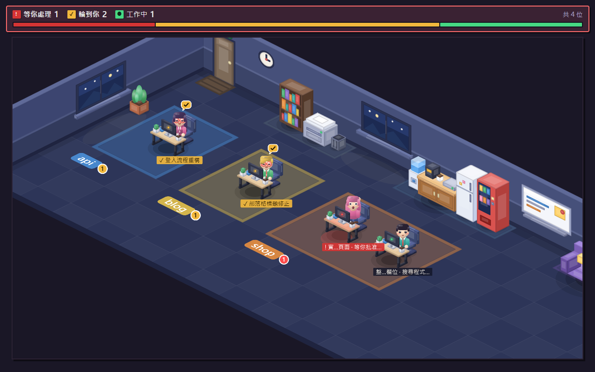

# Claude 辦公室

把本機的 Claude Code session 顯示成黏土質感的 2.5D 等角夜間辦公室：每個 session 是一位員工，subagent 是他的助理，列在員工的資訊卡裡。一眼就能看出哪個 session 還在工作、哪個在等你處理、哪個已經輪到你。



*上圖是 `npm run simulate` 跑到一半、再補一個權限詢問事件的畫面：狀態列圖例「等你處理 1 · 輪到你 2 · 工作中 1 · 共 4 位」，因為有人等你處理，外框是紅色。*

## 功能

- **一個 session 一位員工，一個專案一座島**：依 session 的 cwd 分島，招牌漆在地板上顯示專案名稱。
- **三種狀態一眼分辨**：工作中（打字、名牌接目前動作）、等你處理（站起來舉手、紅色名牌）、輪到你（閉眼休息、琥珀色名牌與打勾泡泡）。
- **狀態列一眼看比例**：圖例依緊急程度列出各狀態人數，下方比例條用紅／琥珀／綠顯示人數比例。
- **分頁標題帶數字**：例如 `(!1 ✓2) Claude 辦公室`，分頁在背景也看得到。
- **助理清單**：subagent 列在主人的資訊卡裡，顯示類型、描述與狀態。
- **請他下班**：滑鼠移到員工身上，從資訊卡直接移除該員工。
- **鏡頭自動對焦有人的島**：島佔的範圍小就放大，範圍大就拉遠。
- **只在本機執行**：伺服器只監聽 127.0.0.1；hook 最多等 300 毫秒，送不到伺服器時靜默結束，不影響 Claude Code。

## 需求

- Node.js（本專案以 Node 22 開發，`@types/node` 為 22 版）
- Windows：hook 會經由 Git Bash 執行，請先安裝 Git for Windows（見下方「已知限制」）

## 快速開始

```
npm install
npm run build
npm run install-hooks
npm start
```

然後用瀏覽器打開 http://127.0.0.1:47823 。之後每個 Claude Code session 送出事件時，員工就會走進辦公室。

## 安裝與建置

```
npm install
npm run build
```

`npm run build` 會依序執行 `tsc`（把 `src/` 的伺服器、hook、installer 編譯到 `dist/`）、`tsc -p web`（前端只做型別檢查，不輸出）與 `vite build`（前端輸出到 `dist/web`）。

## 安裝與移除 hooks

```
npm run install-hooks
```

- 請**先 build 再安裝 hook**：hook 指令指向 `dist/hook/send.js`，沒有 build 就沒有這個檔。
- `install-hooks` 會把 hook 寫入 `~/.claude/settings.json`（13 個事件：SessionStart、UserPromptSubmit、PreToolUse、PostToolUse、PostToolUseFailure、PermissionRequest、Notification、Elicitation、ElicitationResult、Stop、StopFailure、SubagentStop、SessionEnd）。
- hook 寫的是這個資料夾的絕對路徑，**專案搬移後請重新 build 並重新執行 `install-hooks`**。更新版本後也請重新執行一次，才會掛上新增的事件。
- 重複執行不會重複新增：會先拿掉舊的 claude-office 項目再寫入。

移除：

```
npm run uninstall-hooks
```

只會從 `~/.claude/settings.json` 移除 claude-office 的項目（指令帶有 `--tag=claude-office` 的 hook），其他 hook 保留。

- `install-hooks` 與 `uninstall-hooks` 在 `settings.json` 已存在時，會先建立原始檔備份 `settings.json.claude-office.bak`（備份已存在就不會覆蓋，永遠保留最初的原始檔）；原本沒有 `settings.json` 就不會備份。
- `settings.json` 不是合法的 JSON，或 `hooks` 欄位不是物件時，會中止且不做任何修改。

## 啟動

```
npm start
```

然後用瀏覽器打開 http://127.0.0.1:47823 。伺服器只監聽 127.0.0.1，僅限本機存取。滑鼠移到員工身上會出現資訊卡，可按「請他下班」。

port 已被占用時，伺服器會顯示 `port 47823 已被占用，請在 %USERPROFILE%\.claude-office\config.json 修改 port` 並結束，請見「設定」。

## 用 simulate 示範

沒有真實 session 時，可以用模擬事件讓辦公室有人：

```
npm start                       # 先開伺服器（另開一個終端機）
npm run simulate                # 跑一輪 4 個模擬 session（3 個專案）
npm run simulate -- --loop      # 一直重複
```

- `simulate` 只是把事件送給本機伺服器，所以**必須先 `npm start`**；伺服器沒開時會顯示「送不出事件」並結束。
- 它和伺服器讀同一個設定檔取得 port，改過 port 也不用另外指定。
- 一輪約 36 秒（24 個事件，每 1.5 秒一個）：4 位員工分別進入 api、blog、shop 三座島，期間會出現等你處理（權限詢問）、派出助理、輪到你，最後全部下班，辦公室回到空的。想停在某個畫面，可在中途按 Ctrl+C；停下後模擬員工會留在辦公室，直到按「請他下班」、重新啟動伺服器（狀態只存在記憶體），或 12 小時沒有事件。
- 模擬用的假 transcript 放在系統暫存資料夾，結束時（含 Ctrl+C）會自動刪除；不會寫入 `~/.claude` 或 `~/.claude-office`。

## 設定

設定檔只有一個選項 `port`，預設 `47823`：

```json
{"port": 50000}
```

| 系統 | 位置 |
| --- | --- |
| Windows | `%USERPROFILE%\.claude-office\config.json` |
| macOS / Linux | `~/.claude-office/config.json` |

- 沒有設定檔、檔案無法解析，或 `port` 不是 1–65535 的整數時，一律使用預設值 `47823`。
- 伺服器、hook 與 `simulate` 都讀這個檔。改完後**重新啟動伺服器**；hook 每次執行都會重新讀取，所以不必重裝 hook。

## 疑難排解

- **畫面一直是空的**：確認 `npm start` 還在跑，且瀏覽器網址的 port 與設定一致；已經開著的 Claude Code session 要等下一次事件（例如送出下一個 prompt）才會出現。
- **改了 port 但沒有反應**：伺服器要重新啟動；之後新送出的事件才會用新 port。
- **Windows 上所有 hook 一起逾時**：Claude Code 在 Windows 上經由 Git Bash 執行 hook，Git Bash 異常時所有 hook 會一起逾時，辦公室因此收不到事件。這是 Git Bash 的問題，不是 claude-office 的設定；請先確認 `bash.exe -c "echo ok"` 能在一秒內回應。

## 辦公室怎麼排

辦公室是 2:1 等角投影的 2.5D 畫面，深藍色地板的夜間房間：後牆左側有門與門墊，旁邊是時鐘。後牆從左依序是三區靠牆家具，每區底下有一塊地墊，區與區之間掛夜景窗與白板：

1. 書櫃、影印機、垃圾桶
2. 飲水機、茶水櫃、冰箱、販賣機
3. 沙發、邊桌、立燈、貓，最後是一盆大盆栽

這些家具的位置固定，島變多、房間變寬時不會跳動。房間比預設寬（地板寬度 1114 以上）時，後牆右段才會依序多掛橫幅、月曆海報、夜景窗。左牆有窗，每一排島的左邊各有一盆小盆栽。

桌子是沿地板格線斜放的現代電腦桌（淺木薄桌面、霧黑金屬腳、細邊框螢幕，桌上有筆記本、鍵盤、滑鼠、白杯與小盆栽），員工和椅子對齊桌子長邊中間，坐在桌子後方。人物、桌椅與家具烘成貼圖時套用黏土畫法（軟邊、亮塊、漸層與接地投影）。

鏡頭框住所有島（含人頭、名牌與招牌）：範圍小就放大（最多 2 倍），範圍大就拉遠，但不會比「整個房間放進畫面」更遠；放大後房間比畫面大時，畫面不會移到房間外。沒有島時框住整個房間。島增減時鏡頭以 300 毫秒平滑移動。

整張畫布（基準 1280×720）依視窗大小縮放，最大 2.5 倍，最小 0.4 倍；狀態列寬度跟著畫布（最窄 360px）。視窗小到畫布要縮到 0.4 倍以下時，畫布停在 0.4 倍，頁面出現捲軸。

每個專案（以完整路徑 cwd 判斷，一個資料夾一個）是一座桌子「島」，島依最早到班時間由左到右排，排不下就換行。招牌漆在島左前緣的地板上，顯示專案名稱；同名但路徑不同的資料夾，招牌會顯示路徑最後兩層來區分。該島若有 session 等你處理，招牌尾端會立著一個紅色圓形徽章（數字 = 等你處理的人數，會放大縮小）；有 session 輪到你時，再接一個琥珀色徽章（數字 = 輪到你的人數，不動）。

一座島的桌子數是最大座位編號加 1，空桌會保留。桌子多了就加欄：

| 桌數 | 欄數 |
| --- | --- |
| 1–3 | 桌數（一桌一欄） |
| 4–9 | 3 |
| 10–16 | 4 |
| 17 以上 | 5 |

**員工進出**：上班時從房間左側（門的那一側）出現，沿島上方的走道橫向走到座位那一欄，再從桌子間的空隙往下走進座位。下班時，坐在座位上的人照原路走回左側後消失；走到一半就下班的人，先回到走道，再往左走到左牆邊消失。最後一位員工走出去之後，那座島才消失。

**名牌**：每張有人的桌子前方有一行名牌，寫成「名字 · 動作」。名字是 session 標題（transcript 裡的 ai-title），還沒有標題時用第一個 prompt，最多 24 字。太長時先從尾端截動作（至少留 4 字加「…」），還放不下再從中間截名字。名牌固定 13px 字級，不跟著鏡頭縮放；鏡頭倍率低於 0.8 時只顯示名字。員工等你處理時，整條名牌變紅並以「! 」開頭；輪到你時，整條名牌變琥珀色並以「✓ 」開頭，頭上多一個打勾的琥珀色泡泡。泡泡也是固定大小，名牌永遠畫在人物與泡泡之上。

**狀態列與分頁標題**：畫面上方的狀態列分兩行：

- 圖例：依緊急程度排成「等你處理（紅色 !）→ 輪到你（琥珀色 ✓）→ 工作中（綠色 ●）」，每項是色塊符號加人數；人數為 0 的項目變灰。最右側顯示「共 N 位」。
- 比例條：依人數比例分成紅、琥珀、綠三段，人數為 0 的狀態不畫。
- 外框跟著最緊急的狀態變色：有等你處理時外框紅色、底色暗紅；沒有但有輪到你時外框琥珀色；都沒有時維持原本的紫色外框。

瀏覽器分頁標題也會帶數字，例如 `(!1 ✓2) Claude 辦公室`，分頁在背景也看得到；數字為 0 的那一項省略，兩項都是 0 時只顯示 `Claude 辦公室`。

**助理**不佔座位，也不畫在桌邊，只列在主人的資訊卡裡：每位顯示類型標籤（例如 Explore、Plan，取自 subagent 的 `subagent_type`，沒有就不顯示）、描述與狀態。工作中的排前面，最多列 4 位，其餘合併成一行「+N 另有 N 位工作中、N 位已完成」。助理完成後在卡上變暗並標示「完成」，等該員工的下一個事件進來才從清單移除；主人下班時一起消失。助理本身沒有「等你處理」狀態，招牌徽章與狀態列也只算員工；不過 subagent 內部的權限詢問等事件會改變主人的狀態。

**資訊卡**（滑鼠移到員工身上就會出現，移開 0.25 秒後隱藏）：上方一條專案色條，接著是：

- 頭像、標題（同名牌的名字來源）、狀態標籤、專案資料夾名稱
- 目前動作（等你處理時整塊變紅）
- 最近的 prompt；第一個 prompt 和最近的不同時另外列出
- 助理清單（類型、描述、狀態）
- 頁尾：到班時間（HH:mm）與「請他下班」按鈕。按下就送出，沒有確認步驟；失敗時頁尾顯示「操作失敗，請稍後再試」。

## 狀態說明

| 角色 | 狀態 | 外觀 | 觸發 |
| --- | --- | --- | --- |
| 員工 | 工作中 | 坐在桌前打字（雙手交替），螢幕背面指示燈綠色，名牌後面接目前動作 | 送出 prompt（UserPromptSubmit）、工具執行（PreToolUse，AskUserQuestion 除外），批准或回答之後（PostToolUse、PostToolUseFailure、ElicitationResult） |
| 員工 | 等你處理 | 站起來舉手，名牌整條變紅並以「! 」開頭，桌面泛紅、螢幕背面指示燈變紅，招牌出現紅色數字徽章 | 要跳權限詢問（PermissionRequest）、Claude 用 AskUserQuestion 問你（PreToolUse）、MCP 要你輸入（Elicitation），或 `notification_type` 為 `permission_prompt`、`elicitation_dialog`、`elicitation_url_dialog` 的 Notification |
| 員工 | 輪到你 | 坐著閉眼、身體輕輕上下浮動，頭上琥珀色泡泡打勾，名牌整條變琥珀色並以「✓ 」開頭，桌上白杯冒煙、螢幕背面指示燈琥珀色，招牌出現琥珀色數字徽章；維持到下一個改變狀態的事件（通常是你送出下一個 prompt） | 回合結束（Stop、StopFailure）；新 session 剛出現、還沒收到會改變狀態的事件時（例如只收到 SessionStart）也是這個狀態 |
| 員工 | 下班 | 走出辦公室後消失（見「員工進出」） | SessionEnd、按「請他下班」、12 小時沒有任何事件（伺服器每分鐘檢查一次） |
| 助理 | 工作中 | 主人資訊卡的助理清單出現一列，狀態為工作中 | subagent 啟動（`PreToolUse` 的 `Agent`，相容舊名 `Task`），或用 SendMessage 叫回已停下的 subagent |
| 助理 | 完成 | 該列變暗並標示「完成」，該員工下一個事件進來時移除 | 前景助理：同 `tool_use_id` 的 `PostToolUse`／`PostToolUseFailure`，或主 session 回合結束、送出新 prompt；背景助理（`run_in_background`）：同 `agent_id` 的 `SubagentStop` |

## 已知限制

**已驗證**（Claude Code 2.1.307，headless `-p` 實測）

- `PermissionRequest` 會觸發（順序是 `PreToolUse` → `PermissionRequest`）。`PreToolUse` 在權限判斷之前就觸發，所以要靠 `PermissionRequest` 才能把員工切到等你處理。
- `run_in_background` 的 Agent：`PostToolUse`（`status: "async_launched"`）與主 session 的 `Stop` 都早於助理真正結束，所以背景助理要等同 `agent_id` 的 `SubagentStop` 才算完成。
- 強制終止 Claude Code 行程時，收不到 `Stop` 與 `SessionEnd`，員工會留在辦公室，直到按「請他下班」或 12 小時後自動離開。

**未驗證**（需要互動式 session，headless 無法錄製）

- `Notification` 的權限提示：headless 模式完全沒有 `Notification` 事件。程式依官方 hooks 文件的 `notification_type` 判斷；沒有 `notification_type` 時才退回用訊息文字判斷。
- `AskUserQuestion`：headless 沒有這個工具。程式依工具名稱把它算成等你處理，並預期你回答後的 `PostToolUse` 讓員工回到工作中。
- Elicitation（MCP 輸入）：依官方 hooks 文件的事件與 `notification_type`（`elicitation_dialog`、`elicitation_url_dialog`）判斷。
- 按 Esc 中斷、直接關閉終端機視窗：會不會送出 `Stop`／`SessionEnd` 尚未確認。如果沒有送出，員工會停在原本的狀態，直到下一個事件、按「請他下班」，或 12 小時後自動離開。

**Windows**：hook 經由 Git Bash 執行，Git Bash 異常時 hook 會一起逾時（見「疑難排解」）。

細節見 `docs/findings.md`。

## 開發與測試

```
npm test            # vitest
npx tsc             # 編譯伺服器、hook、installer 到 dist/（含型別檢查）
npx tsc -p web      # 前端型別檢查（不輸出檔案）
npm run build       # tsc + tsc -p web + vite build
```

架構一行：hook 腳本（`src/hook/send.ts`）把事件 POST 給本機伺服器（`src/server`），狀態由 `src/state` 整理後推給瀏覽器，前端用 Phaser 4 畫辦公室（`web/src`）。設定讀取在 `src/config.ts`，hook 安裝器在 `src/installer`。

美術全是向量圖形，素材資料是 `web/src/flat.ts`（圖形清單，等角投影見 `web/src/iso.ts`，牆面與靠牆家具見 `web/src/furniture.ts`），再由 `web/src/art.ts` 用 `web/src/clay.ts` 的 Canvas 2D 黏土畫法烘焙成貼圖，沒有使用外部圖檔。想改外觀時：人物、髮色（`HAIR_COLORS`）、桌椅在 `web/src/flat.ts`，靠牆家具在 `web/src/furniture.ts`，衣服配色（`PALETTE`）與專案配色（`PROJECT_COLORS`）在 `web/src/view.ts`；改完執行 `npm run build`。
